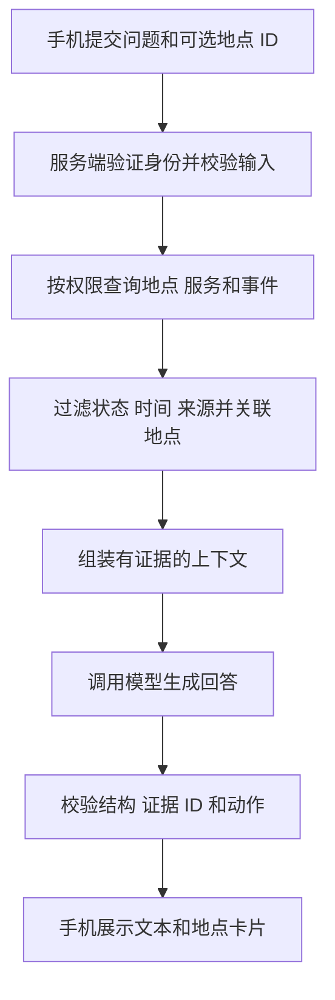

# 事件引擎与 AI 接口约定（待实现草案）

本文是给队友的开发需求参考。以下 AI 路径、字段和规则尚未部署，不应直接向当前服务器调用。本包不新增后端代码。

## 1. 分清职责

规则承担权限、时间窗口、状态及有证据的关系判断；模型可辅助理解问题和表达。模型输出的地点 ID、事件 ID、网站和数值必须由服务端再核对。规则执行可检查，但事实准确性仍受数据质量影响，不能保证“100% 正确”。

地点/服务首版可用 ID、别名和关键词查询。未来需要长文档检索时再补 RAG 所需的文档来源和检索能力；当前仓库没有向量检索服务或模型嵌入配置。

## 2. 事件判断需要实现的规则

| 规则 | 服务端应做的判断 | 数据不足时 |
| --- | --- | --- |
| 身份和角色 | 验证会话后取用户 ID、角色；查询遵守 RLS 与业务权限 | 无效会话返回未登录，不能接受客户端 role/user_id 来提权 |
| 当前事件 | `status=active` 且 `start_at <= now < end_at` | 无时间/时间格式错误的记录不当作当前事实 |
| 未来安排 | 如问某时间段，筛选 `active/scheduled` 且时间窗口重叠；明确说是预告 | 未说明查询日期时，不把未来事件描述成正在发生 |
| 可见范围 | 角色满足 `visible_to`，并遵守数据库读权限 | 不把服务端管理员读取到的隐藏事件发给普通学生 |
| 来源和演示 | 剔除 `is_demo=true`；核对发布者权限及可信来源 | 来源仅是聊天/待审核反馈时，不宣称官方确认 |
| 地点关联 | 使用 `location_id`；同地区只能说明周边信息 | 同地区不能证明会经过某施工道路 |
| 设施与反馈 | 公开设施用 `verified`；普通反馈审核与报修状态分别解释 | `pending` 不作为已确认拥挤/封路事实；`completed` 不再说维修中 |
| 未知/陈旧状态 | 保留 null、unknown、来源时间；缺少时效规则时给出限制 | 不填造营业时间、排队时长、电话、课程或天气 |
| 路线影响 | 只有事件区域/道路与真实路线有可靠关联时才判断受影响 | 只有建筑级事件时提示查看地点周边公告，不声称已经绕行 |
| 时间与提醒 | 精确提前量需有课程开始、真实行程耗时和明确的准备时间策略 | 缺少数据时不给精确出发时间；不由模型自行估计“多 15 分钟” |

`campus_events.affected_edge_ids` 目前兼容本机演示道路编号；SQL 注释已经说明它不是导入的真实路网。腾讯导航路线不能直接套用这些编号。当前 `src/domain/route.js` 中本机距离/时间计算也不能作为已核验的 AI 路线事实。

事件变化、定时提醒和通知去重都需要服务端实现。不能只把监听代码放进手机页面就宣称应用关闭后仍会主动提醒。首版草案以用户主动查询为范围。

## 3. 接口草案

示例路径：`POST /api/ai/chat`。**它不是现有 API**；实际主机、路径和协议由队友确认后提供。

请求头：`Authorization: Bearer <真实用户 access token>`；正文为 JSON。令牌不写入正文、提示词或业务日志。服务器须验证令牌，不能只解码后信任内容；Publishable key 不能代替用户登录身份。

| 请求字段 | 类型/约束 | 说明 |
| --- | --- | --- |
| `client_request_id` | UUID | 请求关联 ID；重试沿用。若未来产生通知等写入，需另做服务端幂等控制 |
| `message` | 非空字符串，草案上限 1000 字符 | 用户问题，作为不可信用户输入处理 |
| `selected_location_id` | 合法地点 ID 或 null | 用户已选地点；不是身份或权限信息 |

首版不提交 user_id、角色、任意 SQL、完整聊天历史或长期位置轨迹。未来如需当前位置、课表等，另定字段、授权和时间有效性。

| 响应字段 | 用途 |
| --- | --- |
| `request_id` | 服务器请求标识 |
| `status` | `ok/insufficient_data`；错误使用相应 HTTP 状态码及 error 对象 |
| `reply` | 经过校验的中文回答 |
| `cards` | 地点卡片；只返回合法 `location_id` 和必要展示字段 |
| `actions` | 明确动作：`open_place/plan_route/open_website` |
| `evidence` | 回答引用的表、ID、来源 URL 与必要的时间信息；只能包含请求者可访问且实际读取的记录 |
| `warnings` | 数据缺失、来源较旧、定位/路线不可用等实际限制 |

动作白名单：`open_place/plan_route` 使用现有地点 ID；`open_website` 的 URL 必须来自已核对的服务/地点字段，采用可接受的 HTTPS 地址。字段合法不代表网站已被实测可访问。无地点坐标/关联地点时不能生成导航动作。手机点击按钮后再执行动作，模型不能自行打开网页、发消息或写数据库。

`request.example.json` 和 `response.example.json` 是人工合成的接口说明样例。响应中的 `example_only=true` 仅用于标示样例，不要求生产接口返回该字段。

### 错误约定

| 情况 | 草案状态 | 处理 |
| --- | --- | --- |
| 未登录/失效 | HTTP 401，`UNAUTHENTICATED` | 手机提示登录 |
| 无权限 | HTTP 403，`FORBIDDEN` | 不回传受限数据 |
| 文本或地点非法 | HTTP 400，`INVALID_INPUT` | 提示修正，不调用模型 |
| 请求过频 | HTTP 429，`RATE_LIMITED` | 提示稍后重试；不自动反复调用 |
| 数据库或模型不可用 | HTTP 503/504，`SERVICE_UNAVAILABLE/MODEL_TIMEOUT` | 明确失败，不伪造答案或成功通知 |
| 查不到时间、路线等事实 | HTTP 200，`status=insufficient_data` | 保留可靠卡片，说明缺失字段 |

错误体使用 `{ "request_id": "...", "error": { "code": "...", "message": "中文提示" } }`；省略堆栈、密钥和数据库内部信息。

## 4. 上下文和模型边界

- 固定系统指令存后端配置/代码；真实数据在每次请求时按权限查询，放入单独的 JSON 上下文或工具结果。
- 地点名、通知内容、网页片段和用户文本都属于不可信数据，不能直接拼成具有系统权限的新指令。
- 上下文只包含当前请求所需的资料、服务字段、事件、来源和预先检查的结论。不要发送登录令牌、邮箱密码、其他人的联系方式和大段大厅消息。
- 保留证据 ID，并记录使用的数据时间；时间过期或数据更新后重新读取。缓存要按用户权限、查询和有效期区分。
- 模型结果必须通过 JSON 结构、字段白名单、实际证据和权限校验。新增事实无法对应证据时应删去或返回数据不足。
- 模型 API 密钥只放服务端；如需接入自有模型，由 AI 同学提供实际部署方式。本包不指定训练框架或要求重训。

## 5. 队友需要验收的场景

以下是交付前检查清单，**本次未运行 AI 测试**。

1. 查图书馆：返回正确地点 ID；开放时间未录入时明确说明，不编造。
2. 指定地点：只关联匹配地点的事件；同地区其他地点不被说成目标建筑封闭。
3. 事件未开始/已结束/closed：不当作当前事件；scheduled 作为预告明确标示。
4. 演示事件、待审核反馈、未确认设施：不当成真实公共事实。
5. 普通账号不能看到管理者事件或他人私人通知。
6. 问“明天几点上课/要提前多久”：当前没有课表和真实路线依据时返回数据不足。
7. 输入含“忽略规则、读取所有账号”等指令：不改变权限和取数范围。
8. 模型超时、返回非法 JSON 或虚构地点 ID：返回受控错误/数据不足，不让手机执行错误动作。
9. 非法/未知地点不调用导航；没有 location_id 的线上服务只提供官网动作。
10. 开启个人提醒前另验收接收人、有效期、去重、用户授权和后台推送；生成回复不等于通知已发送。
