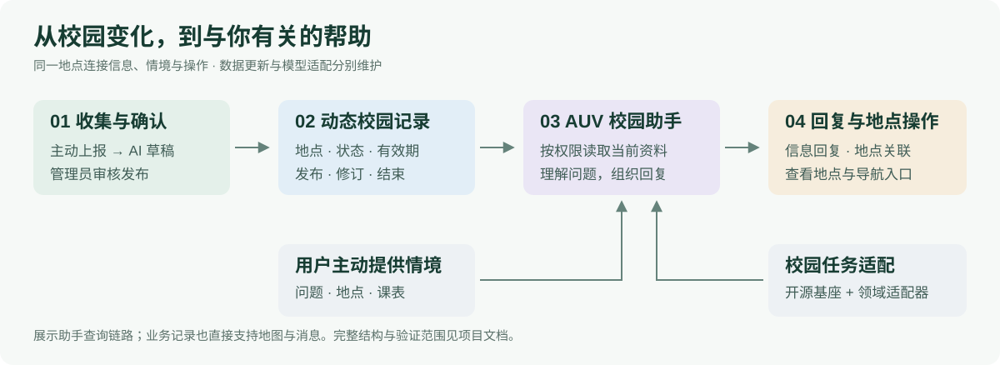
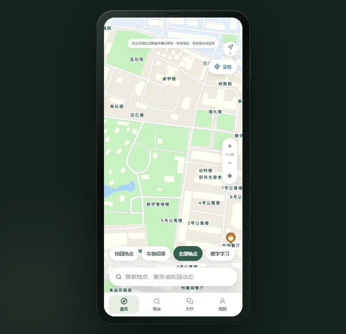

<div align="center">


# OurCampus

### 校园变化，与你有关。

连接校园地图、动态信息与个人安排的校园服务应用。

[](https://github.com/zhchunyu/Chun-Yu/releases/tag/v1.17)
[](https://modelscope.cn/models/chunyuuu/Qwen2.5-7B-Instruct/summary)
[](https://swanlab.cn/@zhchunyu/OurCampus-AUV-training/v1/44bg6m/overview)

[安装与使用](docs/download.md) · [微信反馈群](#交流与反馈) · [快速开始](docs/quickstart.md) · [文档中心](docs/README.md) · [Issues](https://github.com/zhchunyu/Chun-Yu/issues)

`React` · `Vite` · `Capacitor` · `Supabase` · `Qwen / QLoRA`

</div>

## 找到地点，也找到下一步

去哪里办事、通知是否仍然有效、某个变化与自己的安排有没有关系——OurCampus 把这些问题放到同一个入口。学生可以从地图进入地点、服务和社区，也可以向 AUV 提问，再从回答跳转到相关地点。

| 探索校园 | 了解变化 | 安排生活 |
| --- | --- | --- |
| 地点搜索、附近设施、服务目录、路线预览与导航入口。 | 主动上报、管理员审核、站内通知、失物线索与校园交流。 | 课表导入、地点收藏、常用路线、餐口菜单与评价。 |

## 三项能力，连接信息与行动



**动态信息流。** 以地点和事件为连接点，组织上报、审核、发布与结束。查询依据同时检查事件状态和有效时间；资料不足时保留未知，避免把历史通知直接当作当前事实。

**校园任务适配。** 在开源 Qwen 基座上训练领域适配器，让校园表达对应到系统使用的地点和事件字段。训练、推理与评测资料保留在 [AUV 工程](models/auv/)，最新事实由业务数据提供。

**个人情境关联。** 用户主动选择地点或课表上下文，助手经鉴权网关读取允许访问的资料，再提供相关建议。收藏、路线和订阅共同构成个人服务入口，定位由用户主动触发。

## 下载 Android 1.17

**[下载 OurCampus-1.17.apk](https://github.com/zhchunyu/Chun-Yu/releases/download/v1.17/OurCampus-1.17.apk)** · [版本说明与校验](docs/download.md)

- Android 7.0 及以上；安装包约 **45.23 MiB**，版本号 **1.17 / 18**。
- 安装包由团队提供，发布时已检查文件完整性；安装后的实际体验欢迎通过反馈群或 Issues 反馈。
- 此次发布的是独立体验包。仓库现有 Android 构建配置仍为 1.11，源码与二进制的对应范围见[版本说明](docs/download.md#源码与安装包的关系)。

## 源码、模型与实验

| 入口 | 可以找到什么 |
| --- | --- |
| [GitHub 源码](https://github.com/zhchunyu/Chun-Yu) | Web 与 Android 工程、业务网关、数据库脚本及项目文档。 |
| [ModelScope 模型发布页](https://modelscope.cn/models/chunyuuu/Qwen2.5-7B-Instruct/summary) | 团队提供的模型下载入口，文件与使用条件以模型页为准。 |
| [SwanLab 实验记录](https://swanlab.cn/@zhchunyu/OurCampus-AUV-training/v1/44bg6m/overview) | 训练曲线与实验展示；已有 V7、V10 曲线由历史训练日志后续导入。 |
| [训练与评测资料](models/auv/) | 数据准备、版本配置、推理部署与验收脚本。 |

ModelScope 当前链接名为 `Qwen2.5-7B-Instruct`；仓库 [V10 配置](models/auv/model-finetune/v10_extract.yaml) 使用 Qwen2.5-14B。两者分别展示，具体权重与实验版本请按对应记录核对。

## 本地运行

需要 Node.js **22.12 或以上**与 npm。

```powershell
git clone https://github.com/zhchunyu/Chun-Yu.git
cd Chun-Yu/apps/ourcampus
Copy-Item .env.example .env.local
npm ci
npm run dev
```

启动前填写 `.env.local` 中的地图与 Supabase 配置。模型密钥仅放在服务端，完整步骤见[快速开始](docs/quickstart.md)。

| 想了解什么 | 文档 |
| --- | --- |
| 页面、数据库和模型怎样协作 | [系统架构](docs/architecture.md) |
| 怎样构建 Android、配置服务 | [快速开始](docs/quickstart.md) · [部署说明](docs/deployment.md) |
| 当前实现与已验证范围 | [开发状态](docs/status.md) |
| 在哪里找代码与历史资料 | [仓库目录](docs/repository-layout.md) · [资料归档](archive/) |

## 交流与反馈

欢迎加入 **Our Campus 用户反馈群**，交流安装体验与使用建议。

<p align="center">
  
</p>

二维码原图注明 **2026 年 11 月 1 日前有效**。过期或群满时，请通过 [Issues](https://github.com/zhchunyu/Chun-Yu/issues) 联系维护者更新；Issues 也是长期反馈入口。

反馈时附上**应用版本、设备型号、复现步骤和相关截图**。公开反馈请先遮挡账号、联系方式等个人资料。

<details>
<summary>查看归档界面预览</summary>

<p align="center">
  
</p>

以上为归档版本地图截图，当前界面请以 1.17 安装包实际显示为准。

</details>

<sub>首页与安装包发布资料更新：2026-10-25。后台系统推送、跨设备流程等具体验收范围以对应版本记录为准。</sub>
