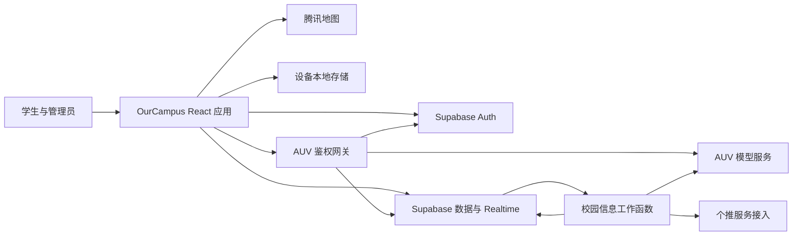
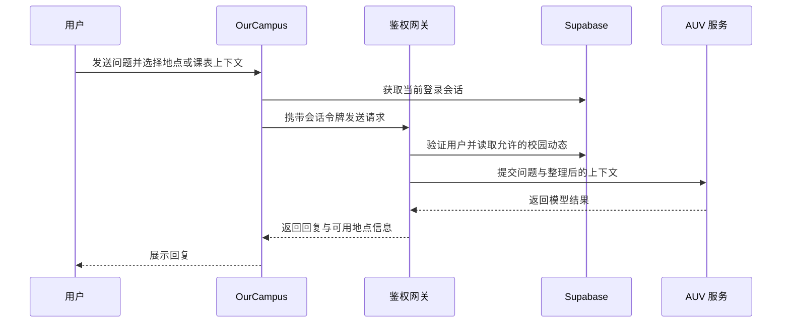
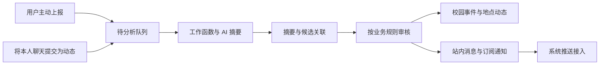

# 系统架构

OurCampus 以校园地点为连接点，将地图、社区信息与 AUV 助手组合为同一个应用。Web 与 Android 共用 React 业务界面，Android 通过 Capacitor 接入设备能力。

## 整体结构

图中展示工程的模块与调用关系。服务接入、系统推送和完整业务流程的验收进度见[开发状态](status.md)。

## 应用工程

主工程位于 [`apps/ourcampus`](../apps/ourcampus/)。

| 目录 | 职责 |
| --- | --- |
| `src/App.jsx`、`src/app/` | 页面组装、应用状态与启动流程。 |
| `src/features/map/`、`locations/`、`routes/` | 校园地图、地点详情与路线界面。 |
| `src/features/mobile/`、`account/` | 手机界面、大厅、个人页与登录会话。 |
| `src/features/reviews/` | 餐厅窗口、评价与筛选。 |
| `src/features/events/`、`notifications/`、`campus-status/` | 校园动态、消息与状态界面。 |
| `src/features/ai/`、`timetable/` | AUV 对话与课表工具。 |
| `src/data/` | 地点与道路数据、本地存储、Supabase 请求和 AI 客户端。 |
| `src/domain/` | 搜索、路线和反馈等业务规则。 |
| `server/` | Vite 开发代理与独立 Node AI 网关适配。 |
| `supabase/functions/` | AUV 与校园信息 Edge Functions 及共享逻辑。 |
| `android/` | Capacitor Android 工程、图标和设备能力接入。 |

模型训练、推理与评测工作集中在 [`models/auv`](../models/auv/)，应用通过服务接口使用模型。

## 地点、社区与个人工具

地图使用腾讯二维地图，并结合工程内的校园地点与道路数据。用户主动点击定位后获取当前位置；地点搜索、详情、路线预览与跳转腾讯地图导航围绕所选地点展开。

账号与大厅聊天使用 Supabase Auth、数据表和 Realtime。账号角色由服务器读取；消息记录、地区筛选、撤回和通知可见范围由业务接口与权限规则共同控制。

收藏、常用路线、附近设施、报修原型与导入课表主要保存在设备本地。课表由用户选择现有 `.xls` 文件后解析，不直接登录教务系统。地点反馈、失物和校园动态可由用户主动选择上报到云端。

## AUV 请求流程

开发环境使用 Vite `/api/auv-assistant` 代理；生产构建默认使用 Supabase `auv-assistant`，也可配置独立 HTTPS 网关。两种入口共用 `supabase/functions/_shared/auv.js` 中的处理逻辑。

模型密钥保存在服务端，客户端携带自己的登录令牌。请求只携带用户主动发送或选择的上下文；助手不会自动读取全部大厅聊天、后台 GPS 或整份私人资料。

## 校园信息流程

工作函数 `campus-information-worker` 处理异步分析与通知任务。施工、封路、停水停电等信息需要管理员确认后才进入面向全体注册用户的站内通知流程；其他信息按订阅与候选匹配规则处理。失物匹配提供线索，归属由当事人核实。餐厅评价独立存储与统计，不进入公共通知分析队列。

普通聊天不会自动送交 AI；历史本机信息不会自动上传。当前失物照片仍为本机资料，联系方式字段不送交模型。

## 服务配置边界

- `auv-assistant` 使用用户会话鉴权，函数内再次验证用户。
- `campus-information-worker` 使用独立后台工作令牌校验，保持现有配置与调用方式。
- 前端只使用 Publishable key，服务器密钥不进入 Web 或 APK。
- 数据表访问规则、Realtime、邮件与任务调度属于后台配置；函数存在并不等于相关用户流程已经验收。

配置位置见[部署说明](deployment.md)，验收事项见[开发状态](status.md)。

[返回文档首页](README.md)
